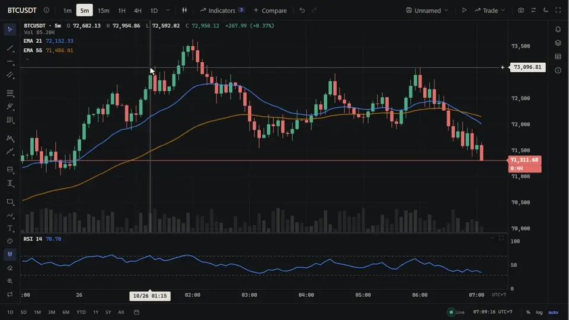
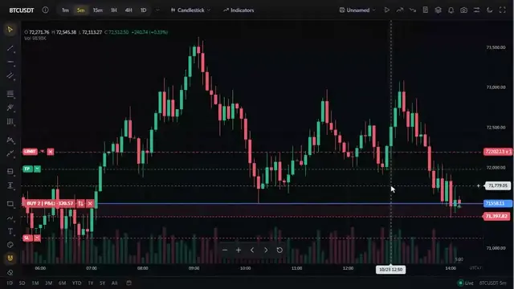
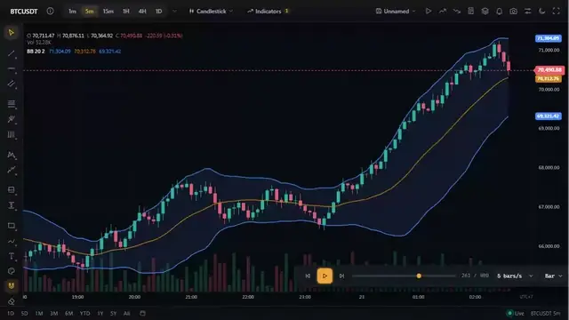
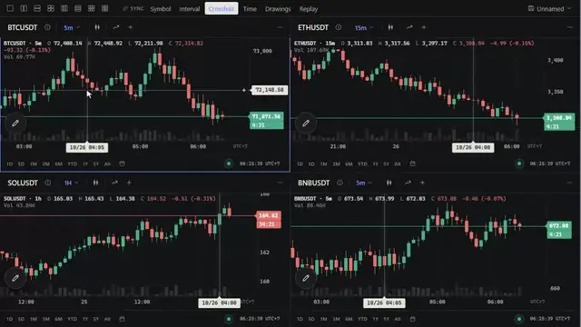
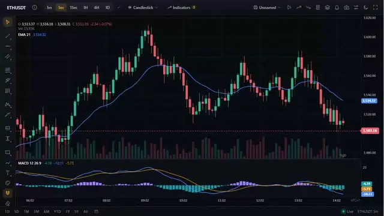
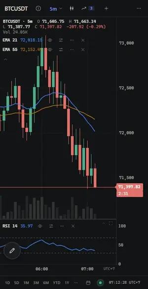

<p align="center">
  <a href="https://tradecanvas.dev/es/"></a>
</p>

<p align="center">
  <a href="https://www.npmjs.com/package/@tradecanvas/chart"></a>
  <a href="https://www.npmjs.com/package/@tradecanvas/chart"></a>
  <a href="https://github.com/bonguynvan/tradecanvas/actions/workflows/ci.yml"></a>
  <a href="https://pkg.pr.new/~/bonguynvan/tradecanvas"></a>
  
  
  <a href="./LICENSE"></a>
  <a href="https://github.com/bonguynvan/tradecanvas/stargazers"></a>
  <a href="https://github.com/sponsors/bonguynvan"></a>
</p>

<p align="center">
  <b><a href="https://tradecanvas.dev/es/chart/">Demo en vivo</a></b> ·
  <a href="https://tradecanvas.dev/es/docs/getting-started/">Documentación</a> ·
  <a href="https://tradecanvas.dev/es/examples/">Ejemplos</a> ·
  <a href="https://tradecanvas.dev/es/audit/">Auditoría del sistema</a> ·
  <a href="./CHANGELOG.md">Registro de cambios</a>
</p>

<p align="center">
  <a href="README.md">English</a> · <a href="README.vi.md">Tiếng Việt</a> · <a href="README.zh-CN.md">简体中文</a> · <a href="README.ja.md">日本語</a> · <a href="README.ko.md">한국어</a> · <b>Español</b>
</p>

**Un gráfico de trading completo para la web.** De velas japonesas a Renko, 134 indicadores, 69 herramientas de dibujo, datos en vivo de exchanges y órdenes sobre el gráfico, dibujado con Canvas 2D o WebGL y sin dependencias de terceros. Usa el `ChartWidget` completo o construye tu propia interfaz sobre el `Chart` headless, en TypeScript, React, Vue o Svelte.

<p align="center">
  <a href="https://tradecanvas.dev/es/chart/"></a>
</p>

## Lo más destacado

- **18 tipos de gráfico, 134 indicadores, 69 herramientas de dibujo**, indicadores sobre indicadores, alertas en líneas, deshacer y rehacer.
- **Trading en el gráfico**: posiciones con P&L en vivo, órdenes y stops que arrastras, un bróker simulado o el tuyo.
- **Datos en vivo** de Binance, Bybit, Coinbase y Kraken, o tu propio feed en unas veinte líneas.
- **Rápido**: un millón de barras desplazadas a 60 fps con WebGL; un tick en vivo en un microsegundo, más o menos.
- **Un espacio de trabajo**: cuadrículas de gráficos, diseños, repetición de barras, backtesting.
- **A tu medida**: temas, tres aspectos, 114 interruptores, plugins; 30 idiomas; móviles y apps.

<table>
  <tr>
    <td width="50%" valign="top">
      
      <br><b>Órdenes que arrastras</b>: stops, objetivos y límites se mueven con el ratón.
    </td>
    <td width="50%" valign="top">
      
      <br><b>Repetición de barras</b>: reproduce un mercado y opera sobre él en simulado.
    </td>
  </tr>
  <tr>
    <td width="50%" valign="top">
      
      <br><b>Cuadrículas</b>: hasta seis gráficos, enlazados por símbolo, intervalo, cruz o tiempo.
    </td>
    <td width="50%" valign="top">
      
      <br><b>Tu aspecto</b>: Studio, Terminal, Capsule, claro u oscuro, o tus propios tokens.
    </td>
  </tr>
  <tr>
    <td width="50%" valign="top" align="center">
      
    </td>
    <td width="50%" valign="top">
      <br><b>En el móvil</b>: un dedo desplaza, hace zoom, dibuja y arrastra órdenes, y el widget se reorganiza para una pantalla pequeña. También funciona en un WebView, React Native, Capacitor o Tauri.
    </td>
  </tr>
</table>

## Inicio rápido

```bash
npm install @tradecanvas/chart
```

```typescript
import { ChartWidget } from '@tradecanvas/chart/widget'
import { BinanceAdapter } from '@tradecanvas/chart'

new ChartWidget(document.getElementById('chart')!, {
  symbol: 'BTCUSDT',
  timeframe: '5m',
  theme: 'dark',
  adapter: new BinanceAdapter(), // datos en vivo, sin API key
  trading: true,
})
```

El `Chart` sin interfaz recibe tus propias barras (`chart.setData(bars)`) y te deja la interfaz a ti. Para React, Vue y Svelte, `@tradecanvas/react`, `/vue` y `/svelte` lo envuelven en un componente con las mismas props.

## Documentación

[Primeros pasos](https://tradecanvas.dev/es/docs/getting-started/) · [API](https://tradecanvas.dev/es/docs/api/) · [Indicadores](https://tradecanvas.dev/es/docs/indicators/) · [Herramientas de dibujo](https://tradecanvas.dev/es/docs/drawing-tools/) · [Tiempo real](https://tradecanvas.dev/es/docs/realtime/) · [Trading](https://tradecanvas.dev/es/docs/trading/) · [Estilos](https://tradecanvas.dev/es/docs/styling/) · [Frameworks](https://tradecanvas.dev/es/docs/frameworks/) · [Plugins](https://tradecanvas.dev/es/docs/plugins/) · [Móviles y apps](https://tradecanvas.dev/es/docs/embed/#mobile-app) · [Rendimiento](https://tradecanvas.dev/es/docs/performance/)

La documentación está en English, Tiếng Việt, 简体中文, 日本語, 한국어 y Español. Las mediciones, los límites y cómo se prueba están en la [auditoría del sistema](https://tradecanvas.dev/es/audit/).

## Herramientas de programación con IA

La skill para agentes de [`skills/tradecanvas`](skills/tradecanvas/SKILL.md) enseña la API a los agentes de programación, con ejemplos cuyos tipos comprueba la CI. En Claude Code:

```text
/plugin marketplace add bonguynvan/tradecanvas
/plugin install tradecanvas@tradecanvas
```

Otros agentes (Cursor, Codex, Copilot y más): `npx skills add bonguynvan/tradecanvas`. Sin skill, [`llms.txt`](https://tradecanvas.dev/llms.txt) y [`llms-full.txt`](https://tradecanvas.dev/llms-full.txt) dan a un asistente la documentación en un solo archivo. ¿Vas a cambiar TradeCanvas con un agente? Las reglas del repositorio están en [AGENTS.md](AGENTS.md).

El servidor MCP `@tradecanvas/mcp` busca indicadores, herramientas de dibujo, opciones, interruptores y claves de estilo en el propio catálogo de la biblioteca, y revisa un objeto de opciones antes de usarlo ([configuración en otros clientes](https://tradecanvas.dev/es/docs/getting-started/#ai)):

```bash
claude mcp add tradecanvas -- npx -y @tradecanvas/mcp
```

En Windows fuera de WSL: `claude mcp add tradecanvas -- cmd /c npx -y @tradecanvas/mcp`. En Git Bash, que ejecuta los comandos `!` de Claude Code en Windows, escribe `//c`: Git Bash convierte `/c` en una ruta.

## Más

- **Paquetes**: [`@tradecanvas/chart`](https://www.npmjs.com/package/@tradecanvas/chart) (el gráfico y el widget), [`react`](https://www.npmjs.com/package/@tradecanvas/react) · [`vue`](https://www.npmjs.com/package/@tradecanvas/vue) · [`svelte`](https://www.npmjs.com/package/@tradecanvas/svelte), y [`analytics`](https://www.npmjs.com/package/@tradecanvas/analytics) para backtests, y [`mcp`](https://www.npmjs.com/package/@tradecanvas/mcp) para agentes de programación.
- **Versiones preliminares**: cada pull request y cada commit en `main` está en [pkg.pr.new](https://pkg.pr.new/~/bonguynvan/tradecanvas), instalable antes de publicarse.
- **Navegadores**: Chrome 80+, Edge 80+, Firefox 80+, Safari 14+.
- **Para empresas**: ningún logo que mostrar, nada que solicitar; la página [Para empresas](https://tradecanvas.dev/es/business/) responde lo que pregunta una revisión de TI. business@tradecanvas.dev
- **Proyectos relacionados**: [bo-grid](https://github.com/bonguynvan/bo-grid), una cuadrícula de datos rápida en Svelte para la mitad tabular de una mesa de trading.
- **Contribuir**: preguntas en [Discussions](https://github.com/bonguynvan/tradecanvas/discussions), errores en los issues, y [CONTRIBUTING.md](./CONTRIBUTING.md) para pull requests. Problemas de seguridad: [SECURITY.md](./SECURITY.md).
- **Patrocinio**: TradeCanvas es gratuito y se desarrolla en abierto; [GitHub Sponsors](https://github.com/sponsors/bonguynvan) lo mantiene en marcha.

[MIT](./LICENSE)
