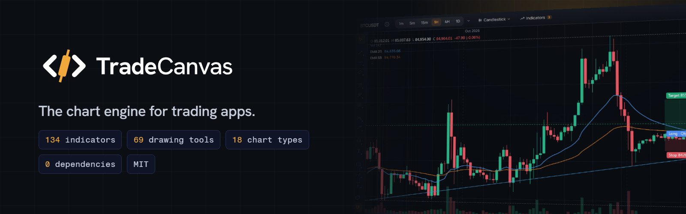
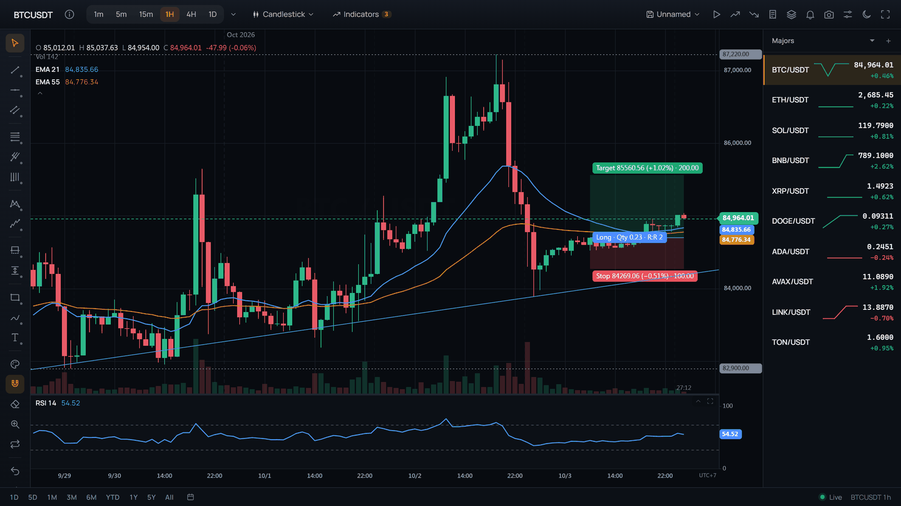
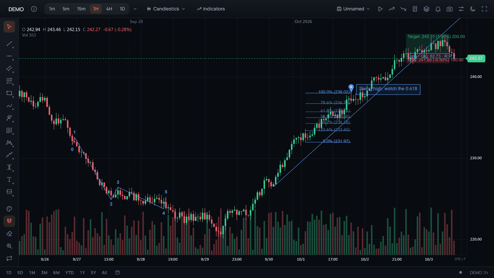
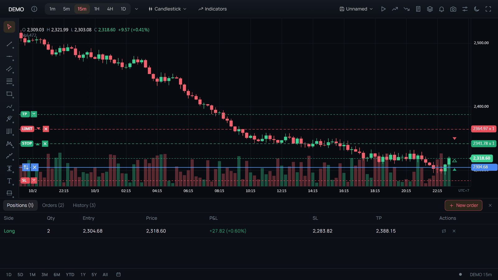
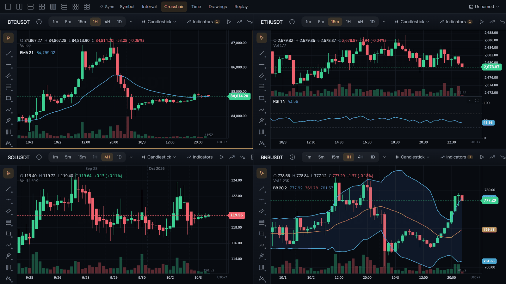
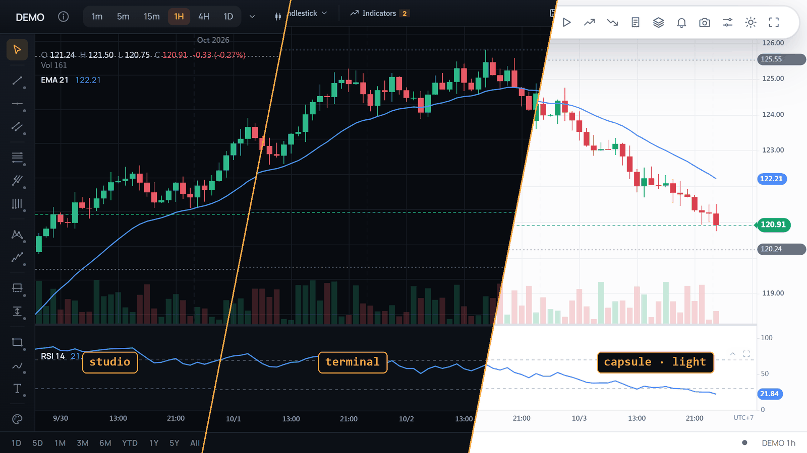

<p align="center">
  <a href="https://tradecanvas.dev/"></a>
</p>

<p align="center">
  <a href="https://www.npmjs.com/package/@tradecanvas/chart"></a>
  <a href="https://www.npmjs.com/package/@tradecanvas/chart"></a>
  <a href="https://github.com/bonguynvan/tradecanvas/actions/workflows/ci.yml"></a>
  <a href="https://pkg.pr.new/~/bonguynvan/tradecanvas"></a>
  
  
  <a href="./LICENSE"></a>
  <a href="https://github.com/bonguynvan/tradecanvas/stargazers"></a>
  <a href="https://github.com/sponsors/bonguynvan"></a>
</p>

<p align="center">
  <b><a href="https://tradecanvas.dev/chart/">Live demo</a></b> ·
  <a href="https://tradecanvas.dev/docs/getting-started/">Docs</a> ·
  <a href="https://tradecanvas.dev/examples/">Examples</a> ·
  <a href="https://tradecanvas.dev/audit/">System audit</a> ·
  <a href="./CHANGELOG.md">Changelog</a>
</p>

<p align="center">
  <b>English</b> · <a href="README.vi.md">Tiếng Việt</a> · <a href="README.zh-CN.md">简体中文</a> · <a href="README.ja.md">日本語</a> · <a href="README.ko.md">한국어</a> · <a href="README.es.md">Español</a>
</p>

**A complete trading chart for the web.** Candlesticks to Renko, 134 indicators, 69 drawing tools, live exchange feeds and orders on the chart, drawn with Canvas 2D or WebGL and free of third-party dependencies. Drop in the full `ChartWidget`, or build your own interface on the headless `Chart`, in TypeScript, React, Vue or Svelte.

<p align="center">
  <a href="https://tradecanvas.dev/"></a>
</p>

## Highlights

- **18 chart types**, from candles and Heikin-Ashi to Renko, Kagi, point & figure and Equivolume, plus six finance charts (sparkline, depth, equity, heatmap, waterfall, gauge).
- **134 indicators and 69 drawing tools**: indicators on indicators, alerts on trend lines, templates, groups, undo and redo.
- **Trading on the chart**: positions with live P&L, orders and stop-loss/take-profit you drag, an order ticket, an account panel, and a paper broker or your own execution adapter.
- **Live data**: Binance, Bybit, Coinbase and Kraken built in, any other feed in about twenty lines; older history while scrolling back, any interval, tick charts.
- **Canvas 2D or WebGL**: a million bars panned at 60 fps, crisp at every screen scale.
- **A full workspace**: multi-chart grids, named layouts, bar replay with paper trading, and a backtester in `@tradecanvas/analytics`.
- **Yours to shape**: 101 style keys, 112 feature switches, three looks, and plugins for indicators, drawing tools, chart types and overlays.
- **For everyone**: the widget in 30 languages, right to left included, with screen reader and keyboard support.
- **On phones and in apps**: a finger does what a mouse does, drawings, orders and alerts included; the widget lays itself out for a phone; the chart keeps the battery in mind, and runs in a WebView, React Native, Capacitor or Tauri.

## Install

```bash
npm install @tradecanvas/chart
```

## Quick start

`ChartWidget` is the whole trading interface in one call: toolbar, drawing sidebar, settings, status bar.

```typescript
import { ChartWidget } from '@tradecanvas/chart/widget'
import { BinanceAdapter } from '@tradecanvas/chart'

new ChartWidget(document.getElementById('chart')!, {
  symbol: 'BTCUSDT',
  timeframe: '5m',
  theme: 'dark',
  adapter: new BinanceAdapter(), // live data, no API key
  trading: true,
})
```

To own the interface, use the headless `Chart` and its API:

```typescript
import { Chart } from '@tradecanvas/chart'

const chart = new Chart(document.getElementById('chart')!, { theme: 'dark' })
chart.setData(bars) // [{ time, open, high, low, close, volume }, …]
chart.addIndicator('ema', { period: 50 })
chart.addIndicator('rsi')
```

Your own feed plugs in through `WebSocketAdapter` or `PollingAdapter`; see [Realtime](https://tradecanvas.dev/docs/realtime/).

## Frameworks

```bash
npm install @tradecanvas/react    # or @tradecanvas/vue, @tradecanvas/svelte
```

```tsx
import { TradeCanvas } from '@tradecanvas/react'

<TradeCanvas symbol="BTCUSDT" timeframe="5m" indicators={['rsi', { id: 'ema', params: { period: 50 } }]} />
```

The three components share the same props and hand you the underlying `Chart`. See [Frameworks](https://tradecanvas.dev/docs/frameworks/).

## A look around

<table>
  <tr>
    <td width="50%" valign="top">
      <a href=".github/assets/drawings.png"></a>
      <br><b>69 drawing tools</b><br>
      Fibonacci, Gann, pitchforks, Elliott waves, harmonic patterns, notes, and a long/short position that sizes the trade.
    </td>
    <td width="50%" valign="top">
      <a href=".github/assets/trading.png"></a>
      <br><b>Trading on the chart</b><br>
      Positions with live P&amp;L, orders you drag to a new price, an order ticket and an account panel.
    </td>
  </tr>
  <tr>
    <td width="50%" valign="top">
      <a href=".github/assets/grid.png"></a>
      <br><b>Multi-chart workspace</b><br>
      Up to six charts side by side, linked by symbol, interval, crosshair, time or drawings.
    </td>
    <td width="50%" valign="top">
      <a href=".github/assets/looks.png"></a>
      <br><b>Your own look</b><br>
      Three presets or your own corners, density, fonts and price tags, on light and dark themes.
    </td>
  </tr>
</table>

## Documentation

| Topic | |
|---|---|
| [Getting started](https://tradecanvas.dev/docs/getting-started/) | Install, the widget, the headless chart |
| [Chart types](https://tradecanvas.dev/docs/chart-types/) · [Indicators](https://tradecanvas.dev/docs/indicators/) · [Drawing tools](https://tradecanvas.dev/docs/drawing-tools/) | What the chart draws, and the settings of each |
| [Realtime](https://tradecanvas.dev/docs/realtime/) | Built-in feeds, your own adapter, history, tick charts |
| [Trading](https://tradecanvas.dev/docs/trading/) | Orders, positions, execution adapters, replay |
| [Styling](https://tradecanvas.dev/docs/styling/) · [Customization](https://tradecanvas.dev/docs/customization/) | Themes, style keys, looks, feature switches, your own parts |
| [Plugins](https://tradecanvas.dev/docs/plugins/) | Your own indicators, drawing tools, chart types and overlays |
| [Analytics](https://tradecanvas.dev/docs/analytics/) · [Finance charts](https://tradecanvas.dev/docs/finance/) | Backtesting and risk metrics; depth, equity and other charts |
| [Phones and apps](https://tradecanvas.dev/docs/embed/#mobile-app) | WebView, React Native, Capacitor, Tauri; touch and page scrolling |
| [Performance](https://tradecanvas.dev/docs/performance/) · [API reference](https://tradecanvas.dev/docs/api/) | Measurements and the full API |

The docs are also in Tiếng Việt, 简体中文, 日本語, 한국어 and Español.

## Performance

Measured in Chrome on integrated graphics (Intel UHD); the [system audit](https://tradecanvas.dev/audit/) has the full table.

| | |
|---|---|
| 1,000,000 bars + 4 indicators, zoomed out, WebGL | 16.7 ms a frame (60 fps) |
| A live tick on 100,000 bars with four indicators | ~0.001 ms |
| `Chart` / `ChartWidget`, minified and gzipped | 176 KB / 315 KB |

## Packages

| Package | |
|---|---|
| [`@tradecanvas/chart`](https://www.npmjs.com/package/@tradecanvas/chart) | The chart and `ChartWidget` (`/widget`) |
| [`@tradecanvas/react`](https://www.npmjs.com/package/@tradecanvas/react) · [`/vue`](https://www.npmjs.com/package/@tradecanvas/vue) · [`/svelte`](https://www.npmjs.com/package/@tradecanvas/svelte) | Framework components |
| [`@tradecanvas/analytics`](https://www.npmjs.com/package/@tradecanvas/analytics) | Backtester and risk metrics |
| `@tradecanvas/core` · `@tradecanvas/commons` | The engine and shared types, installed with the chart |

## Preview builds

Every pull request and every commit on `main` is published to [pkg.pr.new](https://pkg.pr.new), so a fix or feature can be tried before it is released. Install a preview by pull request number or commit:

```bash
npm install https://pkg.pr.new/@tradecanvas/chart@123      # pull request #123
npm install https://pkg.pr.new/@tradecanvas/chart@a1b2c3d  # a commit on main
```

Each pull request gets a comment with the exact commands for every package.

## Browser support

Chrome 80+, Firefox 80+, Safari 14+, Edge 80+.

## AI coding tools

The agent skill in [`skills/tradecanvas`](skills/tradecanvas/SKILL.md) teaches coding agents the API, with examples that CI type-checks. In Claude Code:

```text
/plugin marketplace add bonguynvan/tradecanvas
/plugin install tradecanvas@tradecanvas
```

Other agents (Cursor, Codex, Copilot and more): `npx skills add bonguynvan/tradecanvas`. Without a skill, [`llms.txt`](https://tradecanvas.dev/llms.txt) and [`llms-full.txt`](https://tradecanvas.dev/llms-full.txt) give an assistant the docs in one file. Changing TradeCanvas itself with an agent? [AGENTS.md](AGENTS.md) holds the repo's rules.

## Related projects

- **[bo-grid](https://github.com/bonguynvan/bo-grid)**: a small, fast Svelte 5 data grid for fintech interfaces, the table half of a trading desk. [Live demo](https://bonguynvan.github.io/bo-grid/)

## For businesses

Putting TradeCanvas in front of your customers? There is no logo to show and nothing to apply for. The [For businesses](https://tradecanvas.dev/business/) page answers what an IT review asks, with sources, and describes the first-partner programme. Write to business@tradecanvas.dev.

## Contributing

Questions, ideas and what you built with TradeCanvas go to [Discussions](https://github.com/bonguynvan/tradecanvas/discussions); bugs go to the issues, and pull requests are welcome. [CONTRIBUTING.md](./CONTRIBUTING.md) covers the setup (`pnpm install && pnpm build && pnpm test`) and what a pull request needs. Found a security issue? Please follow [SECURITY.md](./SECURITY.md) instead of opening an issue.

## Sponsor

TradeCanvas is free and MIT-licensed, built and maintained in the open. If it helps your product, you can support its development on [GitHub Sponsors](https://github.com/sponsors/bonguynvan).

## License

[MIT](./LICENSE)
