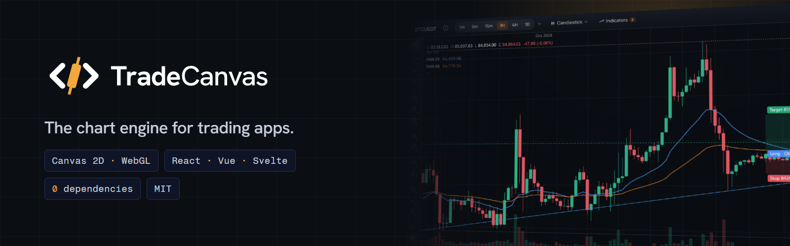
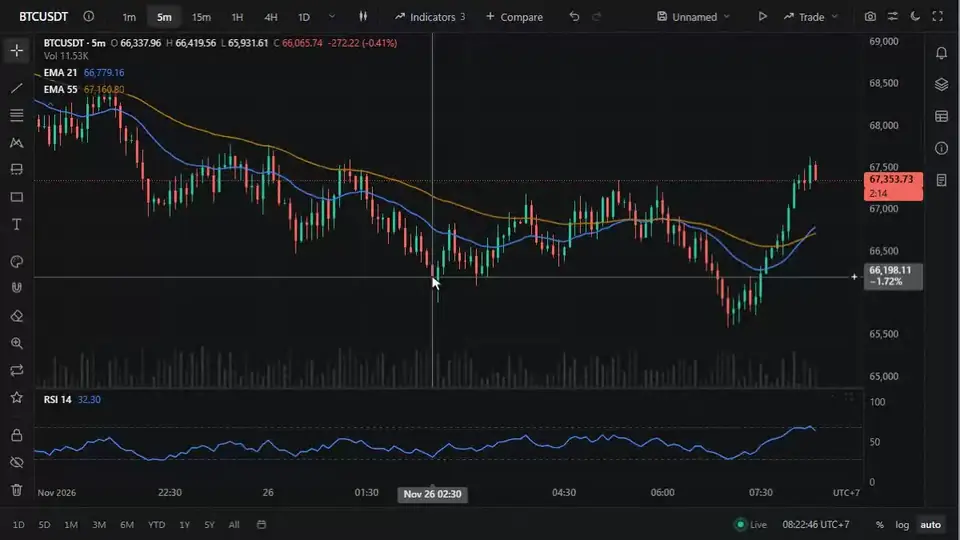
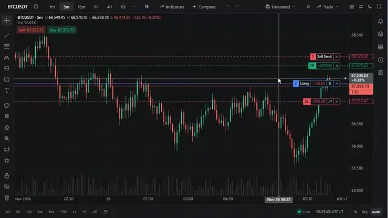
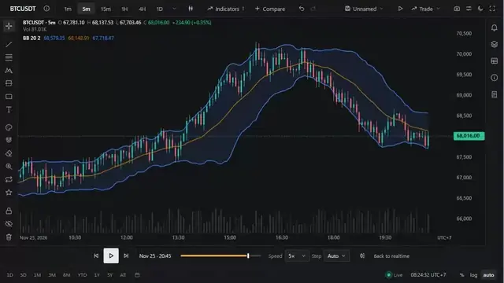
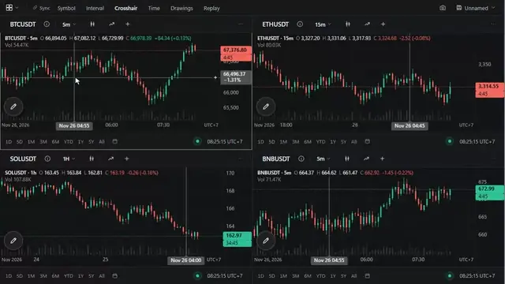
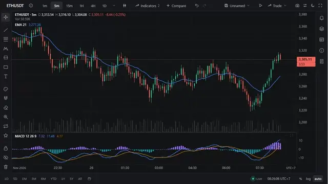
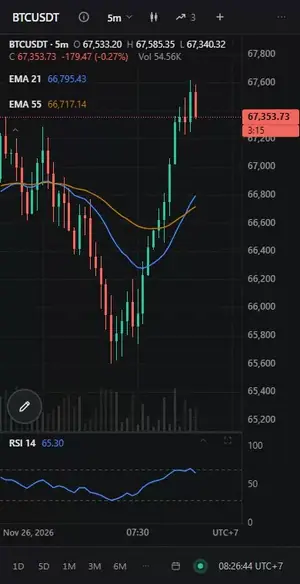

<p align="center">
  <a href="https://tradecanvas.dev/vi/"></a>
</p>

<h3 align="center">Biểu đồ giao dịch thuộc về bạn.</h3>

<p align="center">
  <a href="https://www.npmjs.com/package/@tradecanvas/chart"></a>
  <a href="https://www.npmjs.com/package/@tradecanvas/chart"></a>
  <a href="https://github.com/bonguynvan/tradecanvas/actions/workflows/ci.yml"></a>
  <a href="https://pkg.pr.new/~/bonguynvan/tradecanvas"></a>
  
  
  <a href="./LICENSE"></a>
  <a href="https://github.com/bonguynvan/tradecanvas/stargazers"></a>
  <a href="https://github.com/sponsors/bonguynvan"></a>
</p>

<p align="center">
  <b><a href="https://tradecanvas.dev/vi/chart/">Demo trực tiếp</a></b> ·
  <a href="https://tradecanvas.dev/vi/docs/getting-started/">Tài liệu</a> ·
  <a href="https://tradecanvas.dev/vi/examples/">Ví dụ</a> ·
  <a href="https://tradecanvas.dev/vi/audit/">System audit</a> ·
  <a href="./CHANGELOG.md">Changelog</a>
</p>

<p align="center">
  <a href="README.md">English</a> · <b>Tiếng Việt</b> · <a href="README.zh-CN.md">简体中文</a> · <a href="README.ja.md">日本語</a> · <a href="README.ko.md">한국어</a> · <a href="README.es.md">Español</a>
</p>

**TradeCanvas là thư viện biểu đồ giao dịch mã nguồn mở cho web**, theo giấy phép MIT. Từ nến đến Renko, 134 chỉ báo, 76 công cụ vẽ, feed trực tiếp và lệnh trên biểu đồ, chạy trên Canvas 2D hoặc WebGL, không có dependency bên thứ ba. Dùng `ChartWidget` đầy đủ, hoặc tự xây giao diện trên `Chart` headless, bằng TypeScript, React, Vue hoặc Svelte.

Đây là một chart engine thuộc quyền bạn: giấy phép MIT, cài từ npm và phục vụ cùng ứng dụng của bạn, lấy dữ liệu từ nguồn của bạn, hiển thị dưới thương hiệu của bạn. Không có logo trên biểu đồ, không phải đăng ký xin dùng, không có nền tảng nào đứng giữa bạn và người dùng. Đang dùng charting library của TradingView hoặc Lightweight Charts? Giữ nguyên datafeed: [chuyển từ TradingView](https://tradecanvas.dev/vi/docs/from-tradingview/).

<p align="center">
  <a href="https://tradecanvas.dev/vi/chart/"></a>
</p>

## Điểm chính

- **18 loại biểu đồ, 134 chỉ báo, 76 công cụ vẽ**, chỉ báo tính trên chỉ báo, cảnh báo trên đường vẽ, undo và redo.
- **Giao dịch trên biểu đồ**: position với P&L trực tiếp, order và stop kéo được bằng chuột, broker paper trading hoặc broker của bạn.
- **Dữ liệu trực tiếp** từ Binance, Bybit, Coinbase, Kraken và Upbit, hoặc feed của bạn trong khoảng hai mươi dòng code.
- **Nhanh**: pan một triệu nến ở 60 fps với WebGL; một tick trực tiếp mất khoảng một micro giây; mười phút với 30,000 giao dịch mỗi giây trên một triệu nến mà bộ nhớ không tăng ([soak](benchmarks/2026-11-03.md)).
- **Workspace**: grid nhiều biểu đồ, layout, bar replay, backtest.
- **Thêm mười bốn loại biểu đồ** cho các trang xung quanh biểu đồ chính: depth chart, equity curve, waterfall, heatmap và market map theo ngành, biểu đồ cột, donut, scatter, histogram, calendar, correlation matrix, gauge, sparkline, và một dashboard backtest.
- **Tuỳ biến**: theme, năm look, 133 công tắc tính năng, plugin; 30 ngôn ngữ; điện thoại và ứng dụng.

<table>
  <tr>
    <td width="50%" valign="top">
      
      <br><b>Order kéo bằng chuột</b>: stop, target và lệnh giới hạn di chuyển theo chuột.
    </td>
    <td width="50%" valign="top">
      
      <br><b>Bar replay</b>: phát lại thị trường, rồi giao dịch trên đó bằng paper trading.
    </td>
  </tr>
  <tr>
    <td width="50%" valign="top">
      
      <br><b>Grid</b>: tối đa sáu biểu đồ, liên kết theo mã, khung thời gian, crosshair hoặc thời gian.
    </td>
    <td width="50%" valign="top">
      
      <br><b>Look của bạn</b>: Print (giấy và mực, theo tỉ lệ vàng), Studio, Terminal, Capsule, Desk (cửa sổ giao dịch kiểu desktop), sáng hoặc tối, hoặc token của riêng bạn.
    </td>
  </tr>
  <tr>
    <td width="50%" valign="top" align="center">
      
    </td>
    <td width="50%" valign="top">
      <br><b>Trên điện thoại</b>: ngón tay pan, zoom, vẽ và kéo order, và widget tự chuyển bố cục cho màn hình nhỏ. Widget cũng chạy trong WebView, React Native, Capacitor hoặc Tauri.
    </td>
  </tr>
</table>

## Bắt đầu nhanh

```bash
npm install @tradecanvas/chart
```

```typescript
import { ChartWidget } from '@tradecanvas/chart/widget'
import { BinanceAdapter } from '@tradecanvas/chart'

new ChartWidget(document.getElementById('chart')!, {
  symbol: 'BTCUSDT',
  timeframe: '5m',
  theme: 'dark',
  adapter: new BinanceAdapter(), // live data, no API key
  trading: true,
})
```

`Chart` headless nhận nến của bạn (`chart.setData(bars)`) và để phần giao diện cho bạn. Nguồn dữ liệu riêng là một `DataFeed` gồm hai phương thức (`getBars`, `subscribeBars`), truyền vào `feed` ở mọi chỗ nhận adapter; một feed phục vụ được nhiều biểu đồ. Với React, Vue và Svelte, `@tradecanvas/react`, `/vue` và `/svelte` bọc nó trong một component có cùng bộ props.

## Công cụ AI coding

Agent skill trong [`skills/tradecanvas`](skills/tradecanvas/SKILL.md) cung cấp API cho coding agent, với các ví dụ được CI kiểm tra kiểu. Trong Claude Code:

```text
/plugin marketplace add bonguynvan/tradecanvas
/plugin install tradecanvas@tradecanvas
```

Các agent khác (Cursor, Codex, Copilot và các agent khác): `npx skills add bonguynvan/tradecanvas`. Hoặc yêu cầu agent bất kỳ cài toàn bộ, gồm package, skill và MCP server; agent hỏi phạm vi cài trước:

```text
Install TradeCanvas for me by reading https://tradecanvas.dev/llms.txt
```

Không dùng skill thì [`llms.txt`](https://tradecanvas.dev/llms.txt) và [`llms-full.txt`](https://tradecanvas.dev/llms-full.txt) cung cấp tài liệu cho trợ lý trong một file. Sửa chính TradeCanvas bằng agent? [AGENTS.md](AGENTS.md) chứa các quy tắc của repo.

MCP server `@tradecanvas/mcp` tra chỉ báo, công cụ vẽ, tuỳ chọn, công tắc tính năng và style key trong danh mục của chính thư viện, và kiểm tra một object tuỳ chọn trước khi dùng ([cài đặt cho các client khác](https://tradecanvas.dev/vi/docs/getting-started/#ai)):

```bash
claude mcp add tradecanvas -- npx -y @tradecanvas/mcp
```

Trên Windows ngoài WSL: `claude mcp add tradecanvas -- cmd /c npx -y @tradecanvas/mcp`. Trong Git Bash, nơi chạy các lệnh `!` của Claude Code trên Windows, viết `//c`: Git Bash đổi `/c` thành một đường dẫn.

Chuyển một ứng dụng từ charting library của TradingView hoặc Lightweight Charts? Cùng server đó đối chiếu tuỳ chọn, featureset, override, study, hình vẽ và phương thức của chúng (`migration_plan`, `migration_lookup`, `convert_widget_options`), và `feedFromJsApi` giữ nguyên datafeed ([Chuyển từ TradingView](https://tradecanvas.dev/vi/docs/from-tradingview/)).

Số liệu đo được, không phải tuyên bố: trên 24 task, agent có skill hoàn thành mọi lần chạy (48 trên 48, và 47 trên 48 khi không có skill), với 10 lượt so với 15 và 169k token so với 221k, và đi đọc code đã biên dịch trong 1 trên 48 lần chạy so với 6 ([lần chạy](evals/baselines/2026-11-13-sonnet.md), trên bản 2.1.1; các task và những gì chúng phát hiện ở [`evals`](evals/README.md)).

## Bắt đầu từ template

Ba dự án Vite + TypeScript nhỏ, clone và chạy trong một phút, mỗi dự án là một GitHub template có trang chạy thật:

- **Crypto terminal**: widget trên dữ liệu trực tiếp của Binance, kèm watchlist. [Live](https://tradecanvas.dev/starters/crypto/) · [template](https://github.com/bonguynvan/tradecanvas-starter-crypto)
- **Biểu đồ cổ phiếu**: giờ giao dịch NYSE, nến ngày từ file CSV, hoặc server của bạn qua `udfFeed`. [Live](https://tradecanvas.dev/starters/stocks/) · [template](https://github.com/bonguynvan/tradecanvas-starter-stocks)
- **Workspace**: bốn biểu đồ trong grid 2×2, liên kết crosshair, khung thời gian và thời gian, layout được lưu. [Live](https://tradecanvas.dev/starters/workspace/) · [template](https://github.com/bonguynvan/tradecanvas-starter-workspace)

## Tài liệu

[Bắt đầu](https://tradecanvas.dev/vi/docs/getting-started/) · [Từ TradingView](https://tradecanvas.dev/vi/docs/from-tradingview/) · [API](https://tradecanvas.dev/vi/docs/api/) · [Chỉ báo](https://tradecanvas.dev/vi/docs/indicators/) · [Công cụ vẽ](https://tradecanvas.dev/vi/docs/drawing-tools/) · [Thời gian thực](https://tradecanvas.dev/vi/docs/realtime/) · [Giao dịch](https://tradecanvas.dev/vi/docs/trading/) · [Styling](https://tradecanvas.dev/vi/docs/styling/) · [Framework](https://tradecanvas.dev/vi/docs/frameworks/) · [Plugin](https://tradecanvas.dev/vi/docs/plugins/) · [Điện thoại và ứng dụng](https://tradecanvas.dev/vi/docs/embed/#mobile-app) · [Hiệu năng](https://tradecanvas.dev/vi/docs/performance/)

Tài liệu có bằng English, Tiếng Việt, 简体中文, 日本語, 한국어 và Español. Số liệu đo, giới hạn và cách kiểm thử nằm ở trang [system audit](https://tradecanvas.dev/vi/audit/).

## Thêm

- **Package**: [`@tradecanvas/chart`](https://www.npmjs.com/package/@tradecanvas/chart) (biểu đồ và widget), [`react`](https://www.npmjs.com/package/@tradecanvas/react) · [`vue`](https://www.npmjs.com/package/@tradecanvas/vue) · [`svelte`](https://www.npmjs.com/package/@tradecanvas/svelte), [`analytics`](https://www.npmjs.com/package/@tradecanvas/analytics) cho backtest, và [`mcp`](https://www.npmjs.com/package/@tradecanvas/mcp) cho coding agent.
- **Preview**: mọi pull request và commit trên `main` có trên [pkg.pr.new](https://pkg.pr.new/~/bonguynvan/tradecanvas), cài được trước khi phát hành.
- **Trình duyệt**: Chrome 80+, Edge 80+, Firefox 80+, Safari 14+.
- **Giấy phép**: MIT, một giấy phép cho mọi đối tượng, dự án cá nhân hay sản phẩm của công ty: không phải hiện logo, không phải đăng ký xin dùng.
- **Cho doanh nghiệp**: trang [Cho doanh nghiệp](https://tradecanvas.dev/vi/business/) trả lời các câu hỏi khi bộ phận IT đánh giá. business@tradecanvas.dev
- **Liên quan**: [bo-grid](https://github.com/bonguynvan/bo-grid), data grid nhanh cho Svelte, dùng cho phần bảng của một màn hình giao dịch.
- **Đóng góp**: câu hỏi ở [Discussions](https://github.com/bonguynvan/tradecanvas/discussions), bug ở phần issue, và [CONTRIBUTING.md](./CONTRIBUTING.md) cho pull request. Vấn đề bảo mật: [SECURITY.md](./SECURITY.md).
- **Tài trợ**: TradeCanvas miễn phí và được phát triển công khai; [GitHub Sponsors](https://github.com/sponsors/bonguynvan) giúp dự án tiếp tục.

[MIT](./LICENSE)
